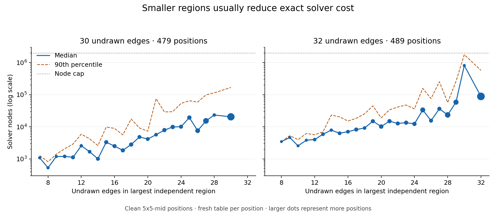

# CPU solver work on 5x5 Dots and Boxes

**Yes: at a fixed number of undrawn edges, the current solver usually visits fewer
nodes when the largest independent region is smaller.** For a largest region of
20 edges versus an unsplit board, median nodes were 4,166 versus 20,481 at 30
undrawn (4.9x fewer), and 10,205 versus 88,469 at 32 undrawn (8.7x fewer).

Job 1 is complete. Labelling is in progress; only completed, verified phases are tabulated below.

## Machine, checkout, and inputs

- CPU: Intel Xeon Platinum 8573C; `nproc=5`; CPU cgroup quota is four CPU equivalents.
- RAM: 18,932,244,480 bytes reported by `/proc/meminfo`; cgroup limit 16 GiB.
- At job start: 15,149,719,552 free bytes,
  17,924,165,632 available bytes; conservative free memory
  after the cgroup limit was 13.891 GB (decimal).
- `N=min(nproc-1, floor(free GB/0.6))=min(4,23)=4`.
  Pilot workers observed around 0.7 GB RSS each, still comfortably within RAM.
- No GPU device nodes; all work used the CPU. Python 3.12.14, GNU C++ 14.2.0,
  CMake 3.31. Raw resource records are in `data/machine.json` and `data/resumed-machine.json`.
- Branch `astra/cpu-solver-work`, based on `claude/awesome-fermi-ygaeuj` at
  `b6a2034c07e4e1f0659ebfce6fbbb393abd775cd`, which supplies `--num-shards`.
  Neither `main` nor the source branch is a push destination.
- Read `CLAUDE.md`, `EXPERIMENTS.md` sections 5–10, and `GETTING_STARTED.md` section 8
  before work; also read `ARCHITECTURE.md` and `PLAN.md`.
- Input upload: `boxes-games-slim.tgz`, 4,628,707 bytes,
  SHA-256 `4ca95b315317fb71fe7b5457665cbd06d556bc087262be7a50d80092f736d132`.
- Extracted **24,474 chains games** and
  **1,714 evaluation games**. All archive members were checked
  to be regular NPZ files under exactly those two tag directories.
- `GAME_DATA_DIR=/workspace/autoboxes-data/game_data_root`. The requested `$HOME/autoboxes-data`
  location was read-only even with an additional filesystem grant, so the configured
  workspace data root was used with the same directory layout.
- `5x5-mid` was used only for measurements. Every labeller command uses
  `--positions-tag 5x5-chains`; no training command was run. The saved mid masks
  are measurement artifacts, separate from the labelled NPZ datasets.

## Build and correctness gate

`uv sync` passed. The first build stopped because Python's relocated installation
still reported `/install/lib/libpython3.12.so`. After the user authorized a local
fix, `scripts/build_cpp.sh` was changed locally to fall back to
`sys.base_prefix/lib/LDLIBRARY` when the configured file is absent. Compilation
then exposed a missing `<algorithm>` include in the existing C++ MCTS test;
`CXXFLAGS='-include algorithm'` supplied it without editing `src/` or `tests/`.

With `PATH=/workspace/autoboxes-tools/bin:$PATH`, the build passed in **104.121 s**.
The required `uv run -m pytest tests/test_boxes_*.py -q` passed:
**243 passed in 63.43 s** (67.203 s shell wall time). No solver work ran before that gate.

**The build edit is intentionally uncommitted, as requested.** No source, tests,
or existing loop scripts were edited. Complete failure output and successful
build/test output are preserved in `logs/setup.txt`, `logs/resume-before-fix.txt`,
`logs/build-missing-algorithm.txt`, and `logs/build-and-tests.txt`.

## Job 1: region sizes and solver cost

| Measurement | Wall seconds | Exit code |
| --- | --- | --- |
| region-29-36 | 7.127 | 0 |
| region-nodes-30-32 | 233.408 | 0 |
| solver-bench | 251.311 | 0 |

The first region CSV was copied before the second command overwrote the script's
fixed output filename. Both samples and the final benchmark CSV are preserved
under this report's `data/`. The original requested outputs remain under the loop
folder's `data/` as well. All 1,500 masks are in
`data/positions-5x5-mid-30-32.txt`.

### Region sizes, 4,000 positions at 29–36 undrawn

| undrawn | positions | split | regions | largest (median) | largest <= 20 | largest <= 24 | largest <= 28 |
| --- | --- | --- | --- | --- | --- | --- | --- |
| 29 | 449 | 0.837 | 2.77 | 20 | 0.51 | 0.688 | 0.837 |
| 30 | 448 | 0.799 | 2.61 | 23 | 0.382 | 0.545 | 0.799 |
| 31 | 469 | 0.757 | 2.43 | 25 | 0.328 | 0.473 | 0.742 |
| 32 | 471 | 0.73 | 2.39 | 27 | 0.24 | 0.397 | 0.641 |
| 33 | 481 | 0.699 | 2.21 | 29 | 0.152 | 0.266 | 0.439 |
| 34 | 558 | 0.638 | 2.05 | 30 | 0.075 | 0.185 | 0.385 |
| 35 | 532 | 0.611 | 1.92 | 31 | 0.038 | 0.1 | 0.269 |
| 36 | 592 | 0.59 | 1.81 | 33 | 0.014 | 0.054 | 0.139 |

### Region sizes, the 1,500-position solver-cost sample

| undrawn | positions | split | regions | largest (median) | largest <= 20 | largest <= 24 | largest <= 28 |
| --- | --- | --- | --- | --- | --- | --- | --- |
| 30 | 479 | 0.787 | 2.6 | 23 | 0.388 | 0.545 | 0.787 |
| 31 | 532 | 0.754 | 2.45 | 25 | 0.316 | 0.461 | 0.737 |
| 32 | 489 | 0.767 | 2.45 | 25 | 0.27 | 0.436 | 0.679 |

### Nodes by largest region, holding undrawn count fixed

| undrawn | largest_region | positions | nodes_median | nodes_p90 | capped_fraction_printed |
| --- | --- | --- | --- | --- | --- |
| 30 | 7 | 4 | 1083 | 1268 | 0.0 |
| 30 | 8 | 5 | 531 | 815 | 0.0 |
| 30 | 9 | 4 | 1190 | 1412 | 0.0 |
| 30 | 10 | 11 | 1200 | 2063 | 0.0 |
| 30 | 11 | 17 | 1123 | 2892 | 0.0 |
| 30 | 12 | 8 | 2570 | 5919 | 0.0 |
| 30 | 13 | 12 | 1678 | 4227 | 0.0 |
| 30 | 14 | 16 | 1008 | 2605 | 0.0 |
| 30 | 15 | 19 | 3327 | 9860 | 0.0 |
| 30 | 16 | 19 | 2507 | 8925 | 0.0 |
| 30 | 17 | 20 | 1851 | 5597 | 0.0 |
| 30 | 18 | 21 | 2805 | 17505 | 0.0 |
| 30 | 19 | 15 | 4832 | 9220 | 0.0 |
| 30 | 20 | 15 | 4166 | 7312 | 0.0 |
| 30 | 21 | 12 | 5685 | 74941 | 0.0 |
| 30 | 22 | 21 | 7905 | 29019 | 0.0 |
| 30 | 23 | 24 | 9874 | 29540 | 0.0 |
| 30 | 24 | 18 | 10079 | 53437 | 0.0 |
| 30 | 25 | 23 | 19375 | 64747 | 0.0 |
| 30 | 26 | 32 | 7575 | 58814 | 0.0 |
| 30 | 27 | 53 | 15290 | 98315 | 0.0 |
| 30 | 28 | 8 | 23282 | 114321 | 0.0 |
| 30 | 30 | 102 | 20481 | 167777 | 0.0 |
| 32 | 8 | 1 | 3465 | 3465 | 0.0 |
| 32 | 9 | 2 | 4642 | 5285 | 0.0 |
| 32 | 10 | 2 | 2555 | 3987 | 0.0 |
| 32 | 11 | 3 | 3834 | 6216 | 0.0 |
| 32 | 12 | 10 | 4003 | 5640 | 0.0 |
| 32 | 13 | 12 | 5890 | 6998 | 0.0 |
| 32 | 14 | 6 | 7882 | 23119 | 0.0 |
| 32 | 15 | 13 | 6287 | 20316 | 0.0 |
| 32 | 16 | 12 | 7043 | 15123 | 0.0 |
| 32 | 17 | 18 | 8228 | 18390 | 0.0 |
| 32 | 18 | 10 | 9157 | 25357 | 0.0 |
| 32 | 19 | 18 | 14956 | 44928 | 0.0 |
| 32 | 20 | 25 | 10205 | 19000 | 0.0 |
| 32 | 21 | 21 | 14979 | 33851 | 0.0 |
| 32 | 22 | 18 | 12708 | 41358 | 0.0 |
| 32 | 23 | 20 | 13463 | 47673 | 0.0 |
| 32 | 24 | 22 | 12306 | 36114 | 0.0 |
| 32 | 25 | 36 | 33529 | 157442 | 0.0 |
| 32 | 26 | 17 | 15539 | 75610 | 0.0 |
| 32 | 27 | 18 | 36436 | 253588 | 0.0 |
| 32 | 28 | 48 | 23463 | 57056 | 0.0 |
| 32 | 29 | 40 | 58487 | 259057 | 0.0 |
| 32 | 30 | 3 | 808342 | 1761669 | 0.33 |
| 32 | 32 | 114 | 88469 | 573373 | 0.0 |

The association is strong but not monotonic: geometry and interactions between
regions still matter. At 32 undrawn, the largest-region-30 bin has only three
positions and one reaches the two-million-node cap; its tail is censored.
Sparse small-region bins should not be treated as precise population estimates.
These measurements establish an association under the current solver; they do
not measure the additional speedup a Nimstring decomposition implementation would deliver.

The region measurement starts with a fresh 2^20-entry table for every position
and caps root solves at two million nodes. `solver_bench.py` instead uses a
2^22-entry table (67.1 MB), fresh for each undrawn count and reused across that
count's 200 positions, with uncapped root solves. Its node quantiles therefore
should not be compared as if they came from the same cache protocol or sample.
Region sampling uses all stored games and excludes forced-capture positions;
the benchmark samples self-play games only and does not apply that exclusion.

### Self-play-only timing benchmark

| undrawn | positions | ms_p50 | ms_p99 | ms_max | nodes_p50 | nodes_p99 | nodes_max | solved_within_2000 | solved_within_20000 | solved_within_200000 |
| --- | --- | --- | --- | --- | --- | --- | --- | --- | --- | --- |
| 30 | 200 | 10.616 | 713.67 | 1475.149 | 4488 | 386695 | 779741 | 0.285 | 0.8 | 0.975 |
| 32 | 200 | 52.041 | 3236.101 | 3662.635 | 22322 | 1632968 | 1996706 | 0.015 | 0.475 | 0.86 |
| 34 | 200 | 372.928 | 5377.777 | 14029.185 | 112709 | 2706182 | 7510664 | 0.0 | 0.02 | 0.71 |

Raw printed tables are retained in `logs/region-29-36.txt`,
`logs/region-nodes-30-32.txt`, and `logs/solver-bench.txt`. The node CSV transcribes
the printed bins; its capped fractions retain the script's two-decimal precision.

## Job 2: exact labels from chains games only

The pilot requests 400 positions total with seed 0, split into four disjoint
shards of 100, initially at a 20-million-node budget. The budget is doubled once
only if more than 20% are skipped. The full run uses seed 1, the same sharding,
and at most 60,000 requested positions, sized for approximately 12 hours.

Pilot and full-run verification results are pending.

Wall time is elapsed time for the entire concurrent shard group, including
sampling and output. Per-shard times, requested/sample counts, log paths and exit
statuses are in `data/<phase>-status.json`; each shard has its own complete log.
The node budget applies to individual root/child solver calls, as implemented
by the unchanged labeller; a position is skipped if its root or any child times out.

### Full-run sizing

The full run will be sized from the completed pilot's measured rate.

### Verified positions by undrawn count

Pending.

### Exact final margins for player 1

Pending.

### Exact final margins for the side to move

Pending.

The NPZ format stores one visit per optimal edge in `mcts_visits`, rather than
an already-normalized policy. `verify_labels.py` loads every array from every
output file with NumPy, reconciles per-file and per-shard counts with the logs,
requires nonempty finite visit rows, and checks every normalized policy row sums
to one within absolute tolerance 1e-6. It also checks the 31–36 band, legal policy
support, exact root values, valid final margins and distinct sampled positions.
Per-file counts and hashes are in `data/<phase>-files.csv`; all verification
results are in `data/<phase>-verification.json`.

### Full-run archive

No full-run archive has been created yet.

The NPZ datasets and oracle archive remain on this machine and are excluded from
git. Only the report, logs, measurements, figures and report helper scripts are
intended for the PR.

## Commands, failures, and reproducibility

- `logs/commands.txt` records the original setup/report attempt and publication.
- `logs/resume-setup-commands.txt` records the resumed build, local workarounds,
  input extraction, and job launch environment.
- `logs/resumed-commands.jsonl` records every underlying measurement and label
  command, data root, log path, UTC timestamp, exit code and elapsed wall time.
- `run_cpu_jobs.py` runs the unchanged experiment commands and preserves their
  outputs. `verify_labels.py` verifies the NPZs; `plot_job1.py` produces the figure;
  `write_report.py` assembles this README from the captured evidence.
- Input checksums and counts are in `data/input-manifest.json`. The full per-file
  input manifest is retained at `/workspace/work/cpu-solver/input-manifest-full.json`.
- The initial clone's proxy connection failed in the default sandbox and succeeded
  with the supported network permission. The initial optional chat-output copy
  failed because `/codex` is read-only; the report is available through GitHub.
- The repository ignores `experiments/**/logs/`, so report logs are explicitly
  staged. Verbatim compiler logs retain their original whitespace.
- The chosen source branch had six preexisting file changes relative to `main`
  at clone time. They are inherited; this task's commits contain only this report
  directory. The local build edit must not be staged or committed.
